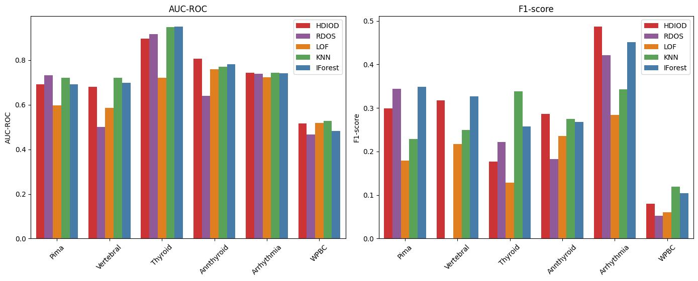
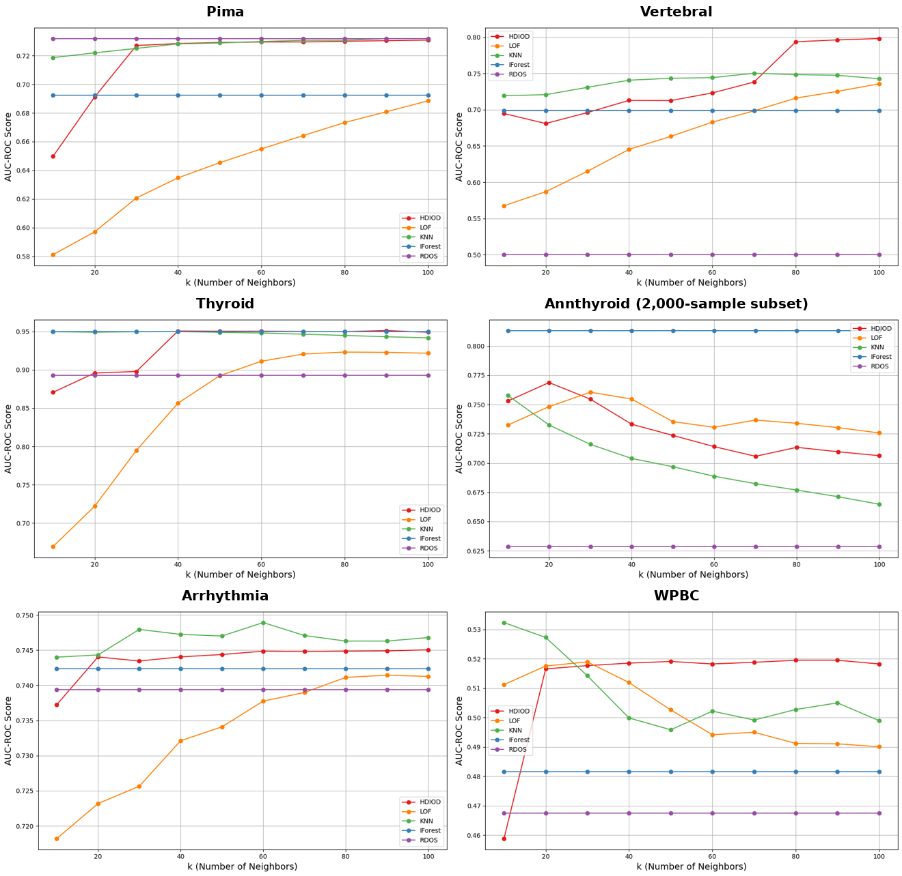

# HDIOD for Medical Outlier Detection

A from-scratch implementation of **High-Density Iteration-based Outlier Detection (HDIOD)** and a benchmark against four common detectors on six public medical datasets.

This repository is a cleaned-up version of my BSc Computer Science dissertation at Newcastle University (2025), supervised by Dr Jichun Li.



## Why this problem

In medical data, the rare cases are often the important ones: an abnormal ECG, an unusual hormone profile, a patient whose cancer comes back. Classic detectors such as LOF and KNN assume that "outlier" means "far from neighbours", which breaks down when clusters have very different densities or when the data is high-dimensional and sparse.

HDIOD (Zhou et al., 2024) takes a different view. Each point climbs towards denser neighbours until it reaches a local density peak. A point whose own density is much lower than the peak it reaches is likely an outlier.

## How HDIOD works

1. **Local density.** Estimate each point's density with a Gaussian kernel over its k nearest neighbours.
2. **High-density iteration.** Move each point to its densest neighbour, repeatedly, until no neighbour is denser. Every neighbour visited on the way is collected into an extended neighbourhood (EkNN).
3. **Centripetal Outlier Factor (COF).** Divide the highest density in the EkNN by the point's own density.
4. **Threshold.** Flag points with `COF > median + c × MAD`, where c = 2.5 by default.

The implementation is in [`src/hdiod/hdiod.py`](src/hdiod/hdiod.py).

## Getting the implementation right

My first implementation followed the paper's description loosely. Its kernel had no bandwidth parameter, and it followed only the densest neighbour without building the EkNN set. Results were unstable, so I re-implemented it with:

- a kernel bandwidth set from the spread of k-NN distances,
- neighbour sets updated at every step and accumulated into EkNN,
- COF computed from the maximum density inside EkNN,
- a step limit to stop points cycling between neighbours of equal density.

| Version (Pima, k = 20) | F1-score | AUC-ROC |
|---|---|---|
| Initial implementation | 0.2319 | 0.6930 |
| Final implementation | 0.2992 | 0.6912 |

The ranking quality (AUC) stayed the same, but the detected outliers became much more accurate (F1 +29%).

## Benchmark

**Detectors:** HDIOD, RDOS (re-implemented), and LOF, KNN and Isolation Forest from [PyOD](https://github.com/yzhao062/pyod). All use k = 20.

**Datasets:** all features are Min-Max scaled. Labels follow the definitions below.

| Dataset | Samples | Features | Anomaly definition | Anomalies |
|---|---|---|---|---|
| Pima Indians Diabetes | 768 | 8 | diabetes onset | 268 (34.9%) |
| Vertebral Column | 310 | 6 | hernia or spondylolisthesis | 210 (67.7%) |
| Thyroid (ann-train) | 3,772 | 6 | class 1 (hyperfunction) | 93 (2.5%) |
| Annthyroid (train + test) | 7,200 | 6 | class 1 or 2 | 534 (7.4%) |
| Arrhythmia | 452 | 274 | any class other than normal | 207 (45.8%) |
| WPBC | 198 | 33 | cancer recurrence | 47 (23.7%) |

### Results (k = 20)

| Dataset | HDIOD | RDOS | LOF | KNN | IForest |
|---|---|---|---|---|---|
| **AUC-ROC** | | | | | |
| Pima | 0.691 | **0.732** | 0.597 | 0.722 | 0.692 |
| Vertebral | 0.681 | 0.500 | 0.587 | **0.721** | 0.699 |
| Thyroid | 0.896 | 0.918 | 0.722 | 0.949 | **0.950** |
| Annthyroid | **0.807** | 0.641 | 0.760 | 0.770 | 0.782 |
| Arrhythmia | 0.744 | 0.739 | 0.723 | **0.744** | 0.742 |
| WPBC | 0.517 | 0.468 | 0.518 | **0.527** | 0.482 |
| **F1-score** | | | | | |
| Pima | 0.299 | 0.344 | 0.180 | 0.229 | **0.349** |
| Vertebral | 0.318 | 0.000 | 0.218 | 0.250 | **0.327** |
| Thyroid | 0.176 | 0.222 | 0.129 | **0.338** | 0.258 |
| Annthyroid | **0.286** | 0.182 | 0.236 | 0.275 | 0.268 |
| Arrhythmia | **0.487** | 0.422 | 0.285 | 0.343 | 0.451 |
| WPBC | 0.080 | 0.052 | 0.061 | **0.119** | 0.104 |

Precision and recall for every model are in [`results/dissertation_results.md`](results/dissertation_results.md).

### Sensitivity to k



### What the results show

- **No detector wins everywhere.** HDIOD had the best AUC on Annthyroid and the best F1 on Annthyroid and Arrhythmia. KNN and Isolation Forest were stronger on Thyroid and Vertebral.
- **HDIOD did best on the largest dataset.** Annthyroid is where its advantage was clearest. A plausible reason is that it mixes dense normal clusters with scattered anomalies, the setting HDIOD was designed for.
- **HDIOD was less sensitive to k than LOF.** Once k reached about 20 to 40, HDIOD's AUC stayed almost flat on Pima, Thyroid, Arrhythmia and WPBC, while LOF kept changing. Very small k (10) hurt HDIOD, and on Vertebral and Annthyroid its AUC still moved with k.
- **WPBC is close to random for every method.** Recurrence is not well separated in this feature space, so an unsupervised detector is the wrong tool here.

## Notes and limitations

- **Threshold tuning.** On the sparse, high-dimensional Arrhythmia and WPBC datasets, `median + 2.5 MAD` flagged almost no points, so c = 1.5 was used there. This is a dataset-specific choice and would need a principled selection rule in practice.
- **RDOS baseline.** The dissertation used a simplified version of RDOS in which each point's neighbourhood covers the whole dataset. This repository also includes the full version described in the original paper (kNN, reverse kNN and shared-NN neighbourhoods), which is now the default. `--legacy-rdos` reproduces the dissertation setting, so the RDOS numbers above refer to the simplified version.
- **Label definitions.** Vertebral and Arrhythmia have high "anomaly" rates (68% and 46%) because every disease class is counted as anomalous. These are closer to disease-vs-normal classification than to rare-event detection.
- **WPBC features.** The `Time` attribute was kept as a feature. Because it is related to the outcome, it should be removed in future experiments.
- **Runtime.** HDIOD's iteration makes it slower than the PyOD baselines, so runtime was not used as a comparison metric.

## Repository structure

```
├── src/hdiod/
│   ├── hdiod.py       # HDIOD detector
│   ├── rdos.py        # RDOS baseline (full version, plus the dissertation setting)
│   ├── datasets.py    # loaders and label definitions for the six datasets
│   └── evaluate.py    # model settings and metrics
├── scripts/
│   ├── run_benchmark.py   # five detectors on all datasets, k = 20
│   └── k_sensitivity.py   # AUC-ROC as k varies from 10 to 100
├── data/README.md     # where to download the raw data
└── results/           # tables and figures
```

## Usage

```bash
pip install -r requirements.txt
# Download the raw files described in data/README.md into data/raw/
python scripts/run_benchmark.py
python scripts/run_benchmark.py --legacy-rdos      # reproduce the dissertation RDOS setting
python scripts/k_sensitivity.py --dataset Annthyroid
```

Using HDIOD on your own data:

```python
from hdiod import HDIOD

labels, scores = HDIOD(k=20).fit_predict(X)   # X: (n_samples, n_features), scaled
```

## References

- Y. Zhou, H. Xia, D. Yu, J. Cheng and J. Li, "Outlier detection method based on high-density iteration," *Information Sciences*, vol. 662, 120286, 2024. [doi:10.1016/j.ins.2024.120286](https://doi.org/10.1016/j.ins.2024.120286)
- B. Tang and H. He, "A local density-based approach for outlier detection," *Neurocomputing*, vol. 241, pp. 171–180, 2017. [doi:10.1016/j.neucom.2017.02.051](https://doi.org/10.1016/j.neucom.2017.02.051)
